  

<i>Bridging red team experience with artificial intelligence.</i>

  

---

### about

I'm an AI practitioner with a background in offensive security. My AI skills include machine vision, CNNs, NLP, geometric deep learning, building agents, tool calling and RAG, along with statistics and classical machine learning.

Right now I'm bringing my red team experience together with what I know about AI, and I'm studying topology to deepen my foundations.

 

 

Before moving into AI, I worked as a red team specialist. The role is to think like an attacker, so that weaknesses are found and fixed before real adversaries exploit them. My work covered three areas: hunting vulnerabilities as a bug bounty researcher, writing exploits to prove how a flaw can actually be abused, and protecting servers, including ESXi virtualization hosts.

 

### stack

 

### focus

| area | details |
|---|---|
| **now** | combining red team experience with AI |
| **vision & deep learning** | machine vision · CNNs · NLP · geometric deep learning |
| **agents** | agents · tool calling · RAG |
| **foundations** | statistics · classical machine learning |
| **learning** | Connecting the present and the past |
| **before** |  bug bounty hunting · exploit writing · server defense (ESXi) |

 

### stats

 

&nbsp;

